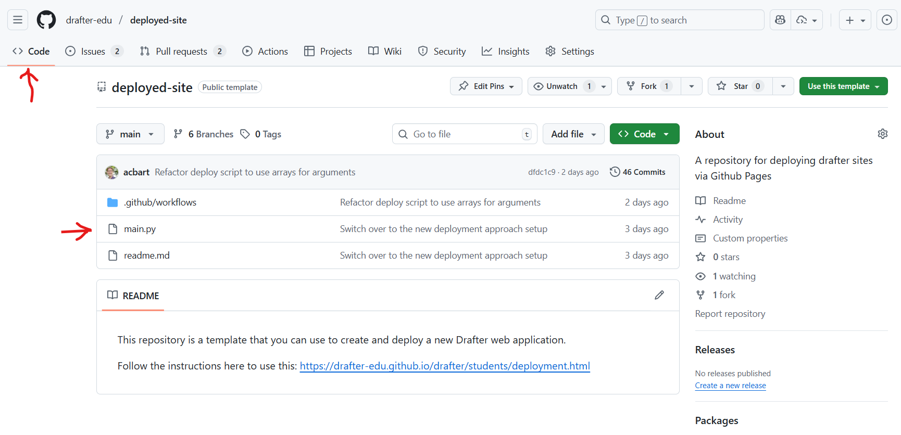
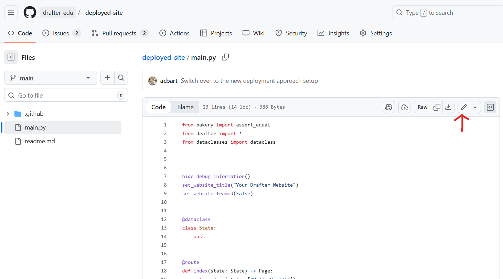
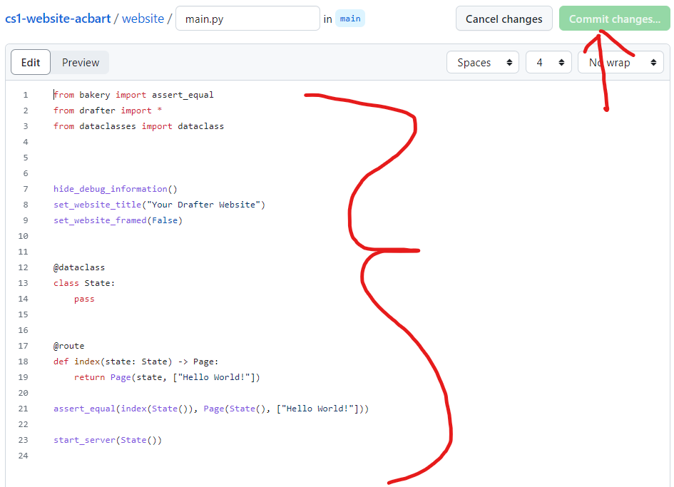
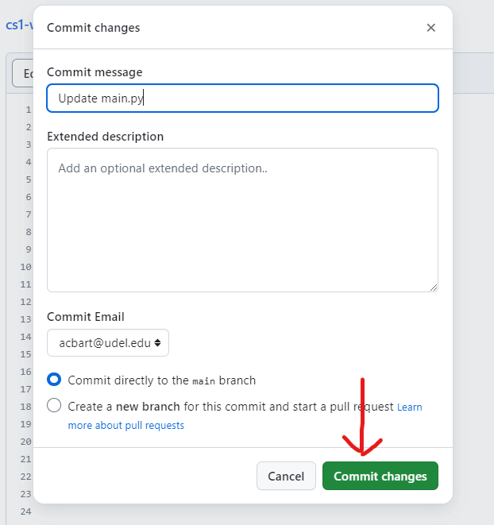
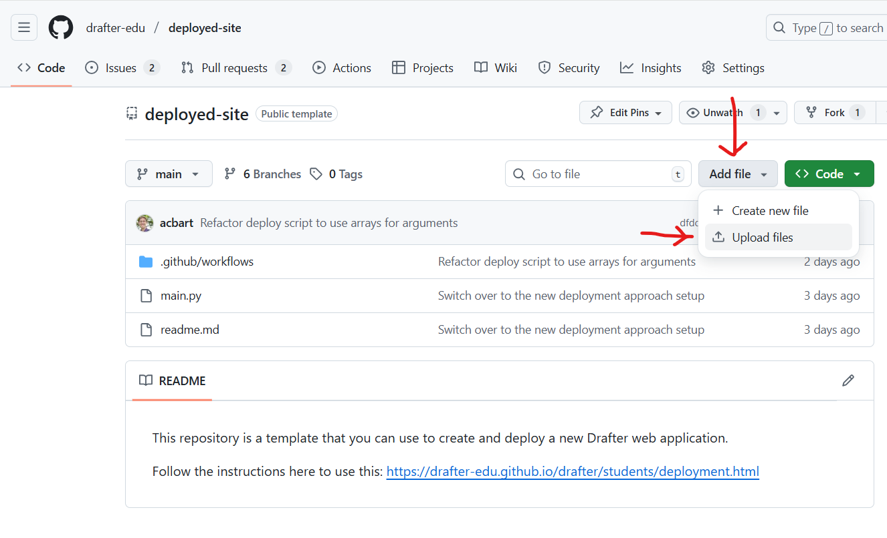
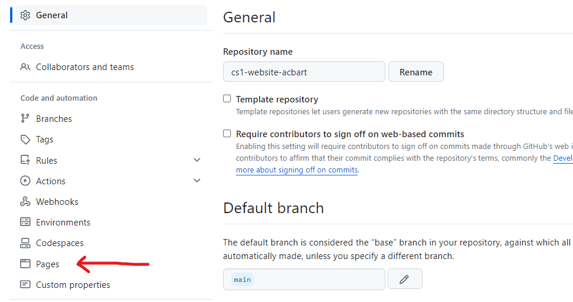
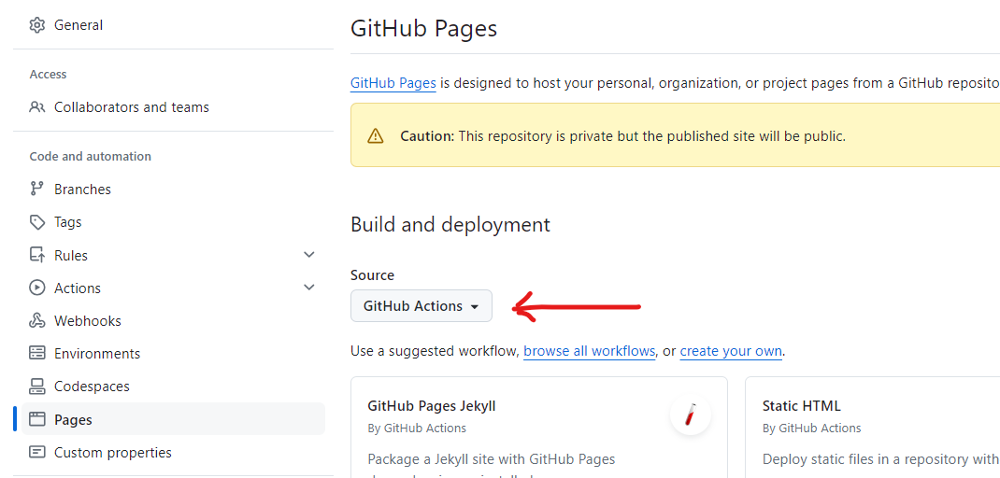
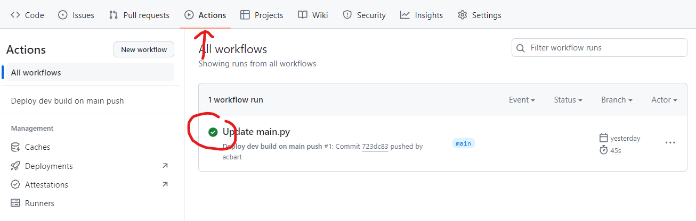
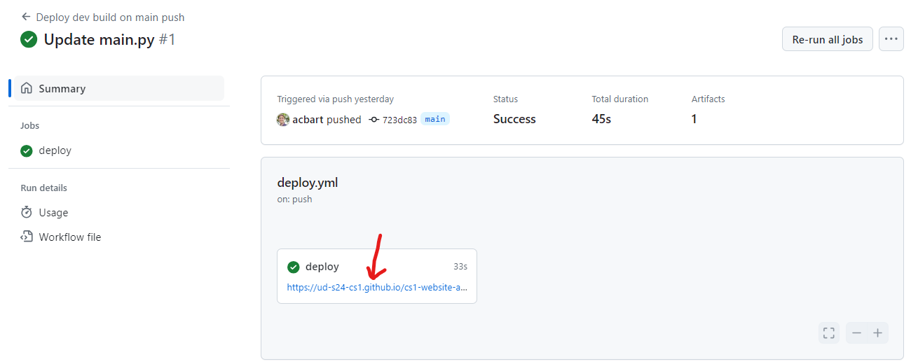

# Publish on GitHub Pages

## Goal

By the end of this page, your prepared app will be live on the web with
a shareable URL, hosted for free by GitHub Pages.

## Before you start

You need a **GitHub account**: [create one here](https://github.com/signup) if
  you do not have one.

!!! note "Choosing a GitHub username"
    Your username will be part of your site's URL and visible to anyone
    you share it with, including future employers looking at your
    portfolio. Pick something professional you will not mind saying in
    an interview: a variation of your name beats `xX_gamer_Xx`. Adding
    your school email to the account (GitHub allows several emails) also
    unlocks student benefits and makes it easier for instructors to
    recognize you.

The overall flow has five parts: create the repository, put your code
in it, turn on Pages, run the workflow, and collect your URL.

## Step 0: Prepare your program

You will need to make sure you [prepared](prepare.md) your program.
This ensures that your app has the correct title, about page, and other necessary configuration before publishing.

If your program already has something like this, then you're good to continue:

```python
set_website_title("Corgi Cafe")
set_site_information(
    author="Your Name",
    description="Order snacks for very good dogs.",
    sources="Thanks to the Drafter docs and my study group.",
    planning=["plan.pdf", "design.pdf"],
    links=["https://github.com/your-username/your-repository"]
)
hide_debug_information()
set_website_framed(False)
```

Otherwise, go through the [prepared](prepare.md) guide first.


## Step 1: Create the repository from the template

1. Open
   [Drafter's deployment template](https://github.com/drafter-edu/drafter-deployment-template-v1/generate)
   (sign in to GitHub if it asks).
2. Leave **Owner** as your account and give the repository a name. The
   name becomes part of your site's URL, so pick something short and
   descriptive: `pet-adoption-site` beats `final-project-attempt3`.
3. Keep the repository **Public**; GitHub Pages requires it on free
   accounts.
4. Click **Create repository**.

The new repository arrives with a starter `main.py` and Drafter's
deploy workflow already in place, so you never have to set those up
yourself.

## Step 2: Put your code in the repository

1. Open your repository on GitHub and go to the **Code** tab.
2. Click `main.py`, then the pencil icon to edit it.
3. Replace its contents with your program (paste from your editor).
4. Click **Commit changes**, write a short message describing the change,
   and confirm.

??? example "Show what this looks like"
    The Code tab lists the repository's files, with `main.py` among
    them:

    

    Opening `main.py` shows its contents; the pencil icon starts
    editing:

    

    After pasting your code, Commit changes is at the top right:

    

    A box asks for a commit message describing your change:

    

Your whole program lives in `main.py`. If your app uses other files,
such as images or data files, add them too: click **Add file**, then
**Upload files**, drag the files in next to `main.py`, and commit.
Every file your program opens must be here, or it will
[404 on the live site](../../help/errors/missing-asset-on-deploy.md).

??? example "Show the upload screen"
    

## Step 3: Turn on GitHub Pages

1. Go to the repository's **Settings** tab.
2. Open the **Pages** section in the left sidebar.
3. Under **Source**, choose **GitHub Actions**.

This is a one-time switch. Skipping it is the single most common cause
of a failed first deployment.

??? example "Show what this looks like"
    The Settings tab is in the repository's top bar:

    

    In Pages, set the Source dropdown to GitHub Actions:

    

## Step 4: Run the deploy workflow

1. Go to the **Actions** tab.
2. Select the deploy workflow in the left sidebar (named something like
   "Deploy main branch as website").
3. Click **Run workflow**, then confirm with the green button.

The deployment takes a minute or two. Watch its progress in the Actions
tab: a green checkmark means success. A red X means something needs
fixing, and [Fix a failed deployment](troubleshooting.md) explains how
to find the exact error and get back on track.

??? example "Show the Actions tab"
    

## Step 5: Find your URL and check your site

1. Click into the successful (green) run; the deployed URL is shown in
   its summary.
2. Open the URL and click through your **whole app**: every page, every
   button, any picture or file it uses.
3. Open it again **on a different device**, like your phone.

??? example "Show a successful run with its URL"
    

The URL looks like `https://your-username.github.io/your-repository/`.
That is your site's address. Share that one, not the `github.com`
repository link and not any `localhost` address.

While you are checking, add `--about` to the end of that address, like
`https://your-username.github.io/your-repository/--about`. That opens
the about page you filled in with `set_site_information(...)`, so you
can confirm the author, description, and links all look right. Courses
often ask for exactly this link.

**Does everything work, on both devices?** Then congratulations: you
built a piece of software and published it on the web, where anyone on
Earth can use it. That is not a small thing. Save the URL somewhere you
will find it again, because this link belongs in a portfolio.

One more thing before you celebrate too hard: if this project is for a
course, **you are probably not done yet**. Courses usually have their
own submission steps beyond deploying, so open your course's
instructions now and finish those while everything is fresh.

## Updating a deployed site

The site redeploys only when you run the workflow, not on every commit.
To publish a change, edit or upload the files (Step 2), then run the
workflow again (Step 4). The newest run in the Actions list determines
what is live.

## Using third-party libraries

A third-party library is one you had to install on your own computer
before you could import it, such as `seaborn` or `pandas`. The deploy
workflow builds your site on one of GitHub's computers, and that
computer does not have the libraries you installed. If your program
imports one, the workflow run stops with `ModuleNotFoundError` until
you list the library in a file named `requirements.txt`.

You can skip this section if your program imports only Drafter, Bakery,
Pillow (`PIL`), Matplotlib, and the modules that come with Python, such
as `random`, `math`, and `dataclasses`. The build computer already has
those.

1. Open your repository on GitHub and go to the **Code** tab.
2. Click **Add file**, then **Create new file**.
3. Name the file `requirements.txt`. The name must match exactly, all
   lowercase, and the file must be in the same folder as `main.py`.
4. Type the name of each library on its own line. For a program that
   imports `seaborn` and `pandas`, the whole file is:

    ```text
    seaborn
    pandas
    ```

5. Click **Commit changes** and confirm.
6. Run the deploy workflow again (Step 4). Committing the file does not
   redeploy the site.
7. When the run turns green, open your site and visit a page that uses
   the library to confirm it works.

Three details about what goes in the file:

- **Use the name you install, not the name you import.** They are
  usually the same, but not always: you write `import sklearn`, and the
  library installs as `scikit-learn`. The install name is the one in
  the `pip install` command on the library's
  [PyPI](https://pypi.org/) page.
- **Leave Drafter out.** The workflow chooses the Drafter version
  itself and ignores a `drafter` line.
- **Add a line whenever you import a new library.** Then commit and run
  the workflow again.

`requirements.txt` covers the build computer only. Each visitor's
browser installs libraries separately, by reading the `import` lines in
`main.py`, and some libraries cannot run in a browser at all. If the
run is green but the site shows an error about a library, see
[A library import fails in the browser](../../help/errors/package-import-error.md).
[Third-party libraries](../../extend/packages.md) explains which
libraries work in the browser and which cannot.

## Common problems

- **The first run fails immediately**: Pages is probably not enabled.
  Redo Step 3, then run the workflow again.
- **The site is up but a picture or file is missing**: the file was
  never uploaded to the repository. Upload it next to `main.py` and
  redeploy.
- **The run fails with `ModuleNotFoundError`**: your program imports a
  library that GitHub's build computer does not have. Follow
  [Using third-party libraries](#using-third-party-libraries) to list
  it in `requirements.txt`, then run the workflow again.
- **The site shows an old version**: you committed changes but did not
  run the workflow again, or the browser cached the old page. Redeploy,
  then hard-refresh.
- For anything else, [Fix a failed deployment](troubleshooting.md)
  shows how to read the error logs.

## Understand it

[Deploy and submit](index.md) explains what compiling to a static site
means.

## See another example

The [project gallery](../gallery/index.md) apps are all published this
way.

## Look it up

The deployment dashboard and logs are described in
[Fix a failed deployment](troubleshooting.md).

## Fix a problem

[Fix a failed deployment](troubleshooting.md) and
[GitHub Actions build failed](../../help/errors/deploy-build-failed.md).

## Next steps

<div class="grid cards" markdown>

- **Next: Get feedback on your design**

    ---

    Your app is live, which means people can actually use it. Learn how
    to watch them do it and make the app better.

    [Get feedback](../get-feedback.md)

</div>
